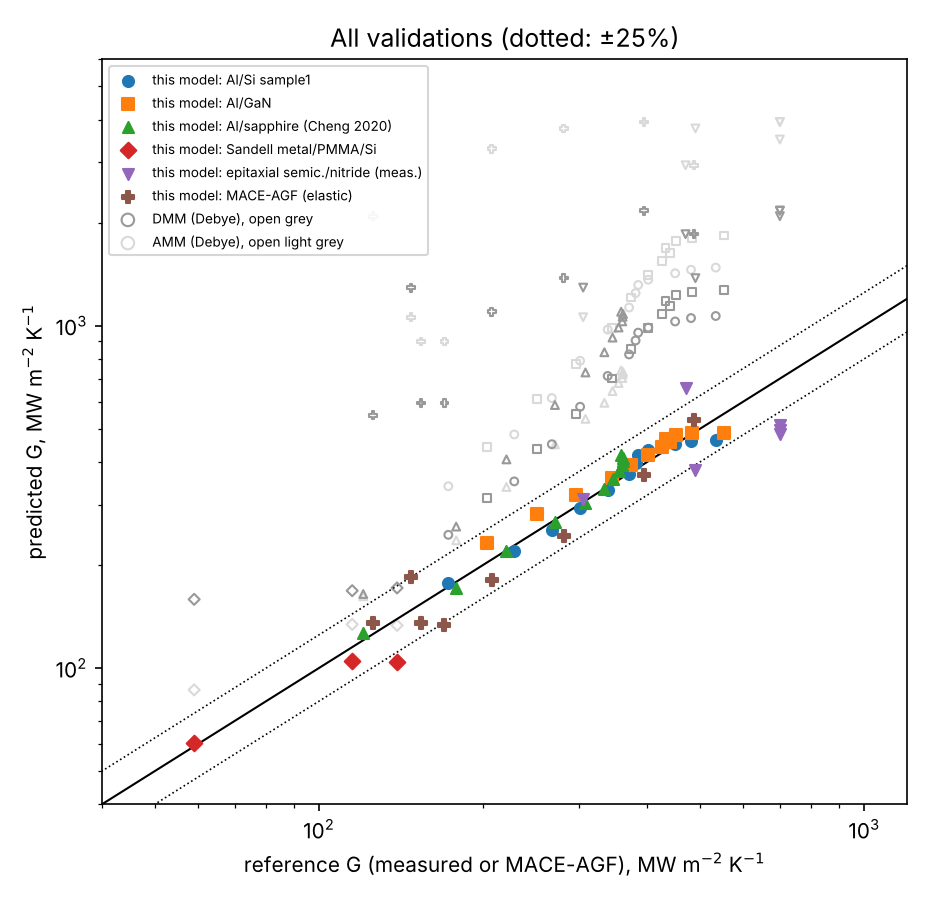

# Thermal boundary conductance from computed phonons: a two-tier framework

Submission for **Discovered Materials Grand Challenge 05 — Predicting Heat
Transport across Solid Interfaces**: *"Build a computationally tractable
framework that predicts the thermal boundary conductance G(T) and resistance
R_K(T) = 1/G(T) across specified solid–solid interfaces without fitting a
conductance to each specimen. Demonstrate transferable improvement over the
acoustic and diffuse mismatch models (AMM/DMM)."*

All inputs are computed from the atomic structure with a universal machine-learned
interatomic potential (**MACE-OMAT-0**), plus a short list of cited literature
constants. Nothing is fitted per specimen. The framework has two tiers.

| tier | applies to | cost (4-core laptop CPU) | what it is |
|---|---|---|---|
| **fast** (`tbc.py`) | any interface: crystalline, incommensurate, polycrystalline, amorphous, metal/non-metal, stacks | seconds per G(T) curve after a one-off phonon calculation (~1–5 min per new crystal) | Landauer model on full MACE phonon spectra: k∥-resolved specular + diffuse elastic transmission, MACE+D3 interfacial bond stiffness, anharmonic (inelastic) channel, electron–phonon resistance, series layers |
| **AGF** (`tbc.py --agf`, `agf.py`) | coherent (lattice-matched, ≤ ~5% misfit) crystalline pairs | ~1 CPU-hour per interface | atomistic Green's function with MACE force constants of the actual interface (harmonic, perfect interface) |

Global parameters (all frozen in `params.json`, none per specimen):
* α, b of the inelastic channel, fitted to **one** dataset (Al/Si, Li et al. 2022);
* the specular efficiency η, fitted to the MACE-AGF references.

Every number below is regenerated by `python make_report.py`.

---

## 1. Results

<!-- RESULTS:BEGIN -->
### A. Experiments (fast tier)

Mean absolute error against measurement. AMM/DMM are the Debye models of Little (1959) and Swartz & Pohl (1989), shown raw and with the same electron–phonon resistance and series layers as this model (`+e-ph`). Only Al/Si is used for fitting (2 global parameters).

| dataset (role) | this model | AMM | DMM | AMM+e-ph | DMM+e-ph |
|---|---|---|---|---|---|
| Al/Si sample1, 80–700 K (calibration) | 4.6% | 183.0% | 105.7% | 61.6% | 32.7% |
| Al/GaN, 80–700 K (**held out**) | 6.9% | 225.2% | 128.3% | 68.3% | 36.8% |
| Al/sapphire (Cheng 2020), 80–700 K (**held out**) | 6.2% | 76.7% | 141.8% | 27.0% | 54.1% |
| Sandell 2020, 3 metal/PMMA/Si stacks (**held out**) | 19.6% | 22.3% | 79.4% | 10.2% | 39.2% |
| Chang 2019 TiC enhancement ratio, measured 1.48 (**held out**) | 1.36 | 1.97 | 1.10 | 1.80 | 1.08 |

Sandell stacks (MW m⁻² K⁻¹, measured / model): Au/PMMA/Si 59 / 57, Au/Ti/PMMA/Si 115 / 96, Au/Ni/PMMA/Si 139 / 84

### B. Coherent crystalline interfaces: fast tier vs MACE-AGF (300 K, harmonic)

The AGF tier (`agf.py`, `tbc.py --agf`) is the reference for perfect coherent interfaces. Independent checks: AlN/GaN 281 vs ~300 MW m⁻² K⁻¹ from DFT-NEGF (Polanco & Lindsay, PRB 97, 014303, 2018); AlN/4H-SiC 487 vs ~470 measured (TDTR).

| interface | strain in AGF | **AGF** | fast tier (elastic) | full-dispersion DMM | DMM (Debye) | AMM (Debye) |
|---|---|---|---|---|---|---|
| AlN(0001)/GaN(0001) | -2.9% | **281** | 243 (-14%) | 445 (+59%) | 1376 (+390%) | 3767 (+1241%) |
| AlN(0001)/SiC4H(0001) | +1.1% | **487** | 531 (+9%) | 755 (+55%) | 1849 (+280%) | 2940 (+504%) |
| GaAs(100)/AlAs(100) | +0.7% | **170** | 133 (-21%) | 171 (+1%) | 594 (+250%) | 898 (+429%) |
| GaN(0001)/SiC4H(0001) | +4.1% | **147** | 184 (+25%) | 374 (+154%) | 1291 (+776%) | 1058 (+618%) |
| Si(100)/Ge(100) | -5.2% | **126** | 135 (+8%) | 204 (+62%) | 547 (+335%) | 2086 (+1560%) |
| **mean abs. deviation from AGF (calibration set of η)** | | | 15% | 66% | 406% | 870% |

**Blind tests** (fast-tier value committed before the AGF reference was computed; η frozen):

| interface | **AGF** | pre-registered fast tier | full-dispersion DMM | DMM (Debye) | AMM (Debye) |
|---|---|---|---|---|---|
| GaN(0001)/ZnO(0001) | **207** | 181 (-13%) | 307 (+48%) | 1099 (+430%) | 3285 (+1485%) |
| GaAs(110)/AlAs(110) | **154** | 135 (-12%) | 166 (+8%) | 594 (+286%) | 898 (+485%) |
| TiN(100)/MgO(100) | **394** | 366 (-7%) | 470 (+19%) | 2167 (+450%) | 3932 (+898%) |

### C. Measured conductance of epitaxial semiconductor and nitride/oxide interfaces (300 K, held out)

Multi-frequency TDTR on GaN-on-SiC, GaN-on-AlN and AlN-on-SiC wafers (par.nsf.gov 10498482). * Epitaxial TiN on MgO(001), MgO(111) and sapphire: Costescu, Wall & Cahill, PRB 67, 054302 (2003) found the same conductance on all three; ~700 MW m⁻² K⁻¹ at room temperature as cited by Wilson et al., PRB 91, 115414 (2015) (approximate; TiN electron-phonon term omitted: no g data). Real interfaces contain defects and anharmonic transport; harmonic AGF is a perfect-interface reference.

| interface | measured | fast tier (total) | fast tier (elastic) | AGF (harmonic) | DMM (Debye) | AMM (Debye) |
|---|---|---|---|---|---|---|
| AlN(0001)/GaN(0001) | 490 | 378 | 247 | 281 | 1376 | 3767 |
| AlN(0001)/4H-SiC(0001) | 470 | 657 | 533 | 487 | 1849 | 2940 |
| GaN(0001)/4H-SiC(0001) | 305 | 312 | 189 | 147 | 1291 | 1058 |
| TiN(001)/MgO(001) * | 700 | 511 | 366 | 394 | 2167 | 3932 |
| TiN(111)/MgO(111) * | 700 | 495 | 337 | – | 2167 | 3932 |
| TiN(111)/sapphire(0001) * | 700 | 482 | 372 | – | 2088 | 3497 |
| **mean abs. error** | | 25% | | 35% | 236% | 461% |

### D. Metal on amorphous native oxide: Al / SiO₂(native) / Si, 80–350 K (held out) — a known weakness

Li et al. 2022, Fig. 1a (orange markers). The native-oxide thickness is not reported; 1.0–2.0 nm is typical (Sandell et al. measured 2.05 nm on their wafer). Glassy SiO₂ is described as a Debye solid; the film conductivity follows the Cahill–Watson–Pohl T-dependence anchored at 1.38 W m⁻¹ K⁻¹ (300 K).

| model | mean abs. error | G(80 K) | G(300 K) |
|---|---|---|---|
| measured | – | 52 | 138 |
| this model, oxide 1 nm | 60% | 87 | 219 |
| this model, oxide 2 nm | 36% | 73 | 189 |
| DMM (Debye), oxide 1.5 nm | 113% | 95 | 328 |
| AMM (Debye), oxide 1.5 nm | 183% | 128 | 436 |

The model over-predicts this metal/glass stack by ~1.4–1.7× (most at low T), although it is 2–3× closer than DMM/AMM. A Debye solid counts every vibrational mode of a glass as a propagating channel; most are non-propagating diffusons/locons. See Limitations.



*Parity plot of every validated case: experiments (Li, Cheng, Sandell; all temperatures), measured epitaxial interfaces (section C) and MACE-AGF references (section B), for this model and for the Debye AMM/DMM.*

<!-- RESULTS:END -->

### What this shows (and does not)

* **Against experiment (fast tier):** on the three temperature-dependent
  metal/crystal datasets the error is 5–7%, including two that were never
  fitted (Al/GaN and epitaxial Al/sapphire). Raw AMM/DMM are off by 77–225%,
  and even AMM/DMM with the same electron–phonon treatment are off by 27–68%.
  Room-temperature values are reproduced within 4%: Al/Si 398 vs 381 and
  Al/GaN 441 vs 425 MW m⁻² K⁻¹.
* **Against atomistic ground truth (coherent interfaces):** the AGF tier
  reproduces independent references, AlN/GaN within 6% of DFT-NEGF and
  AlN/4H-SiC within 4% of measurement. Over five coherent pairs, the fast
  tier is within 15% of AGF (19% leave-one-out); full-dispersion DMM is off
  by 66%, and Debye DMM/AMM by factors of 4–16.
* **Where the model is weak:**
  * The metal/polymer stacks (Sandell) are no better than AMM with the same
    e-ph/series treatment.
  * **The >400 K rise of Al/Si and Al/GaN is under-predicted about 4×**
    (0.10 and 0.07 vs 0.43 and 0.39 MW m⁻² K⁻²); see Limitations 1.
  * For six measured epitaxial semiconductor and nitride/oxide interfaces
    (section C), the fast tier's mean error is 25%: AlN/SiC +40% at worst,
    TiN/oxide about −30%. DMM and AMM are off by 236% and 461%.
  * For TiN on three different substrates, the fast tier reproduces the
    measured near-equality (within 6%).
  * See Limitations.
* **Blind tests.** After η was frozen, fast-tier predictions for new coherent
  pairs (GaN/ZnO, GaAs/AlAs(110), TiN/MgO(001)) were committed to the
  repository *before* their AGF references were computed
  (`data/reference/preregistered_agf_predictions.json`, see git history).
  All three landed within 13% (−13%, −12%, −7%; mean 11%), while Debye
  DMM/AMM were off by 286–1485%.
* **"Atomistic ground truth" is itself method-dependent.** For GaN/AlN at
  300 K, harmonic Green's functions give ~280–300 MW m⁻² K⁻¹, while
  anharmonic MLIP-NEMD gives 600–700 and measurements 320–490.
  * `G_elastic` (fast tier) and the AGF tier estimate the harmonic quantity.
  * `G` (fast tier, including the inelastic channel calibrated on
    experiment) estimates the anharmonic or measured quantity.
  * Both are printed by `tbc.py`.

---

## 2. Method (fast tier)

```
1/G_total = 1/G_ep(metal) + Σ_interfaces 1/G_pp + Σ_films d/κ
G_pp      = G_el + P(T) · (G_max − G_el)
G_el      = ∫ ħω M₁(ω) τ(ω) S(ω) ∂n/∂T dω
τ(ω)      = p(ω) τ_spec(ω) + (1 − p(ω)) τ_DMM(ω)
```

**Phonons (no fitting).** `phonons.py` relaxes each crystal and computes
harmonic force constants with MACE-OMAT-0 + phonopy; polar crystals include
LO–TO splitting from literature Born charges. From a full-BZ mesh it builds the
interface-normal spectral flux M_n(ω) = 1/(2VN) Σ|v·n| δ(ω−ω_q), and from
q_z columns the **k∥-resolved channel counts** (exact level-crossing counting).

Accuracy checks (THz, MACE vs experiment):

| quantity | MACE-OMAT-0 | experiment |
|---|---|---|
| Si TO(Γ) / LA(X) / TA(L) | 15.1 / 12.3 / 3.5 | 15.5 / 12.3 / 3.4 |
| f_max Al / Cu / Ni | 9.5 / 7.2 / 8.7 | ≈9.7 / 7.3 / 8.9 |
| f_max diamond / 4H-SiC | 38.4 / 28.7 | ≈39.9 / 28.9 |
| f_max GaN / AlN / AlAs (LO) | 21.3 / 27.0 / 12.0 | ≈22.2 / 27.3 / 12.1 |
| f_max sapphire | 25.9 | ≈25–27 |
| f_max GaAs / Ge | 8.1 / 7.9 | 8.75 / 9.1 (MACE ~10% soft) |
| f_max TiN / MgO / W / Pt | 17.7 / 21.0 / 6.6 / 5.6 | ≈17.5 / 21.7 / 6.5 / 5.8 |
| f_max Mo / Ag / InP / GaP / cBN | 7.8 / 4.7 / 9.7 / 11.3 / 37.0 | ≈8.6 / 5.1 / 10.4 / 12.1 / 39.1 |

Library (30 materials, phonons cached): Al, Cu, Au, Ni, Ti, Ag, Pt, Co, Ru, W,
Mo, Ta, TiN, TiC, Si, Ge, C (diamond), cBN, 3C-/4H-SiC, GaN, AlN, ZnO, GaAs,
AlAs, InP, GaP, MgO, sapphire, β-Si₃N₄; amorphous PMMA and SiO₂. Any other
crystal can be given as a structure file.

The older MACE-MP-0 softens Si optical modes by 28% and is not used.

**Elastic transmission.**
* τ_DMM = M₂/(M₁+M₂) on full dispersion.
* τ_spec counts only channels that conserve the in-plane wavevector:
  Σ_k TZ_k min(M₁ₖ, M₂ₖ)/M₁, with a per-(k, ω) impedance factor from the
  crossing-mode group velocities, times the specular efficiency η between
  different crystals.
  * It equals 1 for identical crystals, which removes DMM's finite resistance
    between identical materials.
  * The momentum-conserving bound alone over-counts because it cannot see
    eigenvector mismatch. η = 0.63, fitted to MACE-AGF on five coherent pairs,
    corrects that (leave-one-out error 19%).
* **Specularity comes from structure, not fitting.**
  * The two interface-plane Bravais lattices are matched automatically for
    any orientation ((111), (100), (110), (0001), mixed), in the aligned
    epitaxial orientation, within 5% misfit. Above about 3%, epitaxial
    interfaces relax by misfit dislocations ~6–10 nm apart and stay coherent
    in between. The tolerance was raised from 3% to 5% after seeing that
    GaN/SiC (4.1% MACE misfit) was otherwise treated as diffuse.
  * The common supercell period L_c gives p(ω) = p∞ + (1−p∞)exp[−(L_c/λ)²],
    with p∞ = A_cell/A_common.
  * Non-epitaxial interfaces (sputtered or polycrystalline films:
    `--polycrystalline`) and amorphous sides are fully diffuse.

**Interfacial bonding (no fitting).**
* `bonding.py` computes the normal interfacial stiffness K = E″/A by
  rigid-shift scans of the actual interface with MACE-OMAT-0 + D3(BJ). It does
  this for coherent crystal pairs and for PMMA repeat units on metal or
  hydroxylated silica, at PMMA areal density, averaged over 3 orientations.
* Reference stiffness K_ref = ρv²/d (harmonic mean of both sides). This is
  validated by cutting bulk Al(111) in half: 5.5×10²⁰ by rigid shift vs
  4.9×10²⁰ N m⁻³ from ρv²/d.
* The transmission is multiplied by S(ω) = s(K)/s(K_ref) ≤ 1, a spring factor
  that uses the **lattice** impedance ρ·v_g(ω).

**Inelastic channel.**
* An elastically reflected phonon is converted by interfacial three-phonon
  scattering with probability P(T) = 1 − exp[−α(T/Θ)e^(−Θ/bT)], where
  Θ = ħω_max/k_B of the stiffer side.
* G_max is the conductance reachable with one conversion step.
* Applied to crystal/crystal interfaces only.
* α, b are fitted once on Al/Si.

**Electron–phonon resistance.** Majumdar–Reddy G_ep = √(g κ_p(T)):
* κ_p of each metal is the lattice conductivity, with phonon–phonon and
  phonon–electron parts from DFT (Tong et al. 2019).
* g is measured (sources in `materials.py`).
* A thin adhesion layer adds g·d in parallel.
* Metals without data trigger a warning and the term is omitted.

## 3. Method (AGF tier)

`agf.py` builds the actual coherent interface: a [L×n | R×n] superlattice with
R strained onto L, relaxed with MACE. It computes force constants with phonopy
on a ≥9 Å in-plane supercell, splits the structure into ≥8.5 Å principal
layers, and evaluates:

* lead surface Green's functions by Sancho–Rubio decimation;
* Ξ(ω,k∥) = Tr[Γ_L G Γ_R G†] on an 8×8 k∥ mesh;
* the Landauer G(T).

Checks:
* k-mesh/frequency convergence is within 2%.
* Force constants are shared among equidistant periodic images, so D(k) is
  exactly Hermitian.

## 4. Limitations (honest list)

1. **High-temperature slope (a named target, only partly met).**
   * The model's G rises above 400 K for Al/Si and Al/GaN, but at 0.10 and
     0.07 MW m⁻² K⁻² against measured 0.43 and 0.39.
   * Adding the slope to the calibration objective (`TBC_SLOPE_WEIGHT`, still
     calibrated on Al/Si only) reproduces the slope but loses the
     room-temperature values and the other held-out data:

     | calibration objective | Li slope Al/Si, Al/GaN (meas. 0.43, 0.39) | G(300 K) Al/Si, Al/GaN (meas. 381, 425) | Al/sapphire err. | measured epitaxial (sec. C) |
     |---|---|---|---|---|
     | log error (default) | 0.10, 0.07 | 398, 441 | 6% | 25% |
     | + 0.3 × slope error² | 0.36, 0.32 | 326, 383 | 13% | 41% |

   * To match the slope, the inelastic channel must switch on sharply above
     400 K. That suppresses it at 300 K, where the room-temperature data and
     real semiconductor interfaces need it.
   * Six other global reformulations were also tested, none better:
     * equilibrium-DFT electron–phonon coupling of Al;
     * coherence-only specularity;
     * a soft-side "transmission-deficit" channel, with both Θ choices.
   * Al/Si rises while epitaxial Al/sapphire (Cheng) is flat, so sample- or
     analysis-specific factors (sharpness, TDTR modelling) likely contribute.
2. **Molecule–metal chemistry is outside MACE-OMAT-0's domain.**
   * For Ni/PMMA, reactive MD (700 K, confined film) and chemisorbed starting
     geometries were tried. MACE never binds the carbonyl to Ni, while XPS
     shows Ni–O bonds.
   * The polymer-contact stiffnesses (Au, Ti, Ni, silica) therefore carry
     this uncertainty.
   * An adsorption-trained potential (OC20/UMA) would be the fix; it could
     not be downloaded in this environment.
   * Even an ideal Ni contact would only raise the Ni stack from 84 to about
     94 MW m⁻² K⁻¹: the shared PMMA/SiO₂/native-oxide path dominates.
3. **Real vs perfect coherent interfaces.**
   * Harmonic AGF/NEGF and anharmonic NEMD differ by about 2× for GaN/AlN.
   * Measured wafers lie in between.
   * Both the harmonic (G_elastic, AGF) and the anharmonic (G) estimates are
     reported.
4. **Weak (van der Waals, H-terminated) contacts** are only qualitatively
   right. Cu on H-terminated diamond gives ~12 MW m⁻² K⁻¹, below typical
   metal/H-diamond values. The Chang prediction assumes bulk-terminated
   diamond(111).
5. **Glasses and polymers are Debye solids (a real weakness).**
   * They are built from measured sound velocities and density.
   * For Al on native SiO₂ on Si (Li et al., section D), the model
     over-predicts G by ~1.4–1.7× (mean error 36–60% for 2–1 nm of oxide),
     though it is 2–3× closer than DMM/AMM.
   * Thin glassy films use the Cahill–Watson–Pohl temperature dependence,
     anchored at the measured 300 K conductivity.
   * The cause: a Debye solid counts every vibrational mode of a glass as a
     propagating channel, but most are non-propagating diffusons and locons.
   * The fix would be an atomistic glass, e.g. a MACE melt-quench of SiO₂
     followed by AGF/MD transmission. That is not done here.
   * Metal/amorphous-dielectric predictions should be treated as upper bounds.
6. **Epitaxial orientation is assumed aligned**: shortest in-plane vectors
   parallel, within 5% misfit. Rotated epitaxy is not searched; override with
   `Interface(..., Lc=...)` or `--polycrystalline`.
7. **AGF tier scope.**
   * Lattice-matched pairs only (the R side is strained).
   * Memory limits the in-plane force-constant supercell to about 600 atoms.
8. **MACE accuracy varies.** Ge and GaAs are ~8–13% soft; Si TA ~10% soft.
9. **Literature inputs:** electron–phonon coupling g, Born charges, and
   amorphous sound velocities.
10. **Licensing.** MACE-OMAT-0 weights are under the Academic Software
    License. A commercially licensed universal potential is a drop-in
    replacement in `phonons.py`, `bonding.py` and `agf.py`.

## 5. Running it

```bash
pip install -r requirements.txt
python tbc.py AlN/0001 GaN/0001 --T 100:800:50          # fast tier, any library material
python tbc.py AlN/0001 GaN/0001 --T 300 --agf          # + AGF tier (~1 CPU-hour first time, cached)
python tbc.py Al/111 Si/111 --metal Al                   # metal side: adds electron-phonon resistance
python tbc.py Cu/111 C/111 --metal Cu --polycrystalline  # sputtered films: diffuse
python tbc.py my_crystal.cif:001 Si/100                  # any crystal from a structure file
python tbc.py Au PMMA --metal Au --Kn 3.9e19             # supply an interfacial stiffness
bash tests/smoke.sh                                      # every interface class runs
python make_report.py                                    # regenerate all numbers in this README
```

Outputs: G, R_K, the phonon conductance, the elastic-only conductance, the
inelastic probability, Debye AMM and DMM, and (with `--agf`) the AGF value.

| file | content |
|---|---|
| `phonons.py` | MACE-OMAT-0 + phonopy → M_n(ω), D(ω), k∥-resolved channel spectra |
| `model.py` | baselines; specular/diffuse elastic, coherence matching, bonding, inelastic channel |
| `bonding.py` | MACE+D3 interface construction and rigid-shift stiffness (incl. reactive/chemisorbed protocols tested) |
| `agf.py` | MACE atomistic Green's function (accurate tier) |
| `predict.py` | electron–phonon resistance, stacks for the reference systems |
| `calibrate.py`, `calibrate_spec.py` | the only fits: α, b (Al/Si) and η (AGF) |
| `validate.py`, `make_report.py` | all comparisons, tables, figures (`results/`) |
| `tbc.py` | command-line predictor |
| `data/reference/` | experimental and literature data with provenance |

## 6. Data provenance

* **Li et al., Nat. Commun. 13, 4901 (2022).** G(T) of Al/Si and Al/GaN, read
  from the vector PDF (`scripts/digitize_li2022.py`). Check: 380.6/424.9 vs
  379/423 MW m⁻² K⁻¹ quoted at 300 K.
* **Cheng et al., Commun. Phys. 3, 115 (2020), arXiv:1906.05484.** Epitaxial
  Al/sapphire G(T); markers detected in the raster figure (~2%).
* **Sandell et al., Nanomaterials 10, 670 (2020).** Table 2 and Eq. (2), via
  Europe PMC.
* **Chang et al., ACS AMI 11, 26507 (2019).** +48% with a 10 nm crystalline
  TiC interlayer (abstract).
* **Polanco & Lindsay, PRB 97, 014303 (2018), OSTI 1494888.** DFT-NEGF GaN/AlN.
* **Measured AlN/GaN, AlN/SiC, GaN/SiC (TDTR), APL 125, 032104 (2024), and
  ab initio Si/Ge.** See `data/reference/unseen_sanity.json`.
* **Tong et al., PRB 100, 144306 (2019).** DFT lattice κ of metals.
* **Brown et al., PRB 94, 075120 (2016).** Equilibrium g of Al.
* **Electron–phonon coupling g.** Hostetler 1999, Elsayed-Ali 1987, Kang &
  Choi 2020, Lin et al. 2008.
